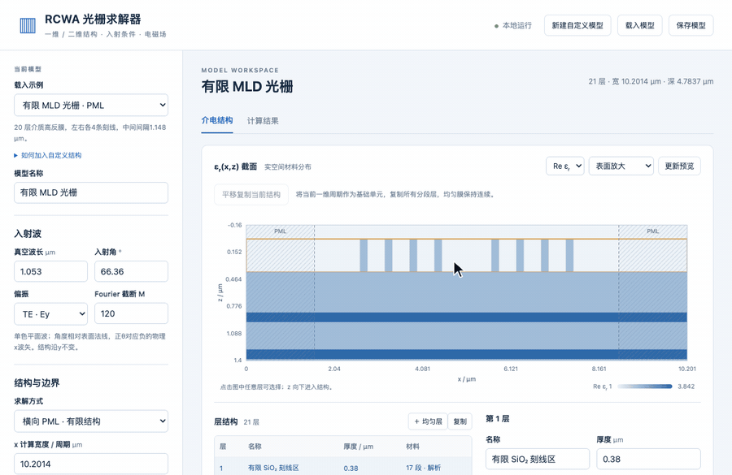
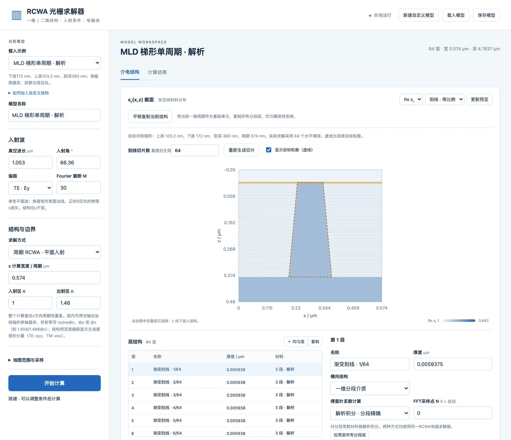
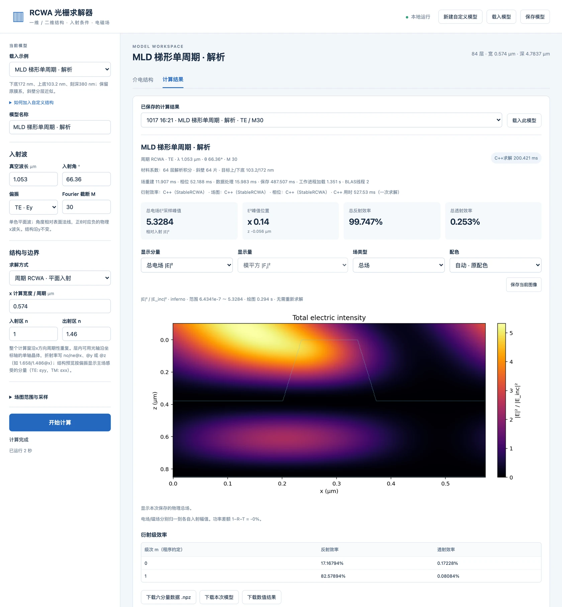

# StableRCWA

**Header-only C++17 RCWA for 1-D and 2-D periodic gratings that stays accurate at high truncation orders.**
RCWA here means rigorous coupled-wave analysis, also called the Fourier modal method.

[](https://github.com/aikkkkko/StableRCWA/actions/workflows/ci.yml)


[](LICENSE)

[中文说明](README.zh-CN.md)



> **Language note.** Program output, error messages, the GUI and the source comments are currently in Chinese.
> This README and the C++ API can be used without reading Chinese. The detailed JSON field reference and the deeper
> documentation are in Chinese for now. On Windows, run `chcp 65001` first so that the UTF-8 output displays correctly.

## Why StableRCWA

- **Stable at high orders.** Every layer eigenproblem is solved with a unitary Hessenberg-QR iteration, so accuracy does not
  degrade as the number of orders grows. Fields propagate by S-matrix recursion. In 1-D TE/TM, modes with exactly zero
  propagation constant get an exact treatment; in conical incidence, degenerate layers switch to a Schur basis.
  The table below solves the same structure with an elimination-based (LR) eigen solver for comparison:

  | Orders M (2M+1 harmonics) | QR (default): Littrow-order efficiency | LR: Littrow-order efficiency | LR: R + T | LR `eig_info` |
  | --- | --- | --- | --- | --- |
  | 60 | 98.586939 % | 98.586939 % | 100.000000 % | 0 |
  | 100 | 98.586941 % | 98.587496 % | 100.000506 % | 0 |
  | 150 | 98.586942 % | **86.618778 %** | **86.900177 %** | 0 |

  The LR solver reports success every time. The only warning sign is the eigen-pair residual, which `rcwa_demo` prints:
  it is 1.4e-4, 1.4e-1 and 1.2e-1 for LR. For QR it stays at or below 8.5e-16, and R + T stays at 100.000000 %.

  <sub>Single-period dielectric grating on a 20-layer mirror, lossless, TE, λ = 1.053 µm, θ = 66.36°.
  Command: `./rcwa_demo --case single --M 150 --eig lr`. Measured on Apple M1 Pro with Apple clang 17.
  The LR numbers change with compiler and CPU; the QR numbers do not.</sub>

- **No external dependencies.** Include the headers and call a function. The FFT library pocketfft is bundled;
  there is nothing to download, build or link first.
- **Complete toolset:**
  - 1-D gratings, TE/TM;
  - conical incidence, with a full 2×2 Jones matrix per order;
  - 2-D crossed gratings;
  - six-component near fields and phase maps;
  - absorbing (complex-index) media.
- **Independently checked:**
  - against COMSOL finite-element models (2-D for conical incidence, 3-D for crossed gratings), comparing complex amplitudes and not only efficiencies;
  - against closed-form solutions and exact physical identities (flux unitarity, reciprocity, mirror, translation and period-repetition equivalence).
- **Three ways to use it:**
  - C++ headers;
  - a JSON-in/JSON-out command-line program, callable from Python, MATLAB or scripts;
  - a local web GUI for modelling and viewing fields without writing code.

## Quick start (one minute)

You need any C++17 compiler.

```sh
git clone https://github.com/aikkkkko/StableRCWA.git
cd StableRCWA
c++ -std=c++17 -O2 -I include -I examples examples/rcwa_demo.cpp -o rcwa_demo
./rcwa_demo --case single --M 20
```

The first lines of the output:

```text
结构 single，TE，M = 20（N = 41），本征分解用 QR 迭代
  第 1 级反射效率  98.586865 %
  R = 99.794843 %   T = 0.205157 %   R + T = 100.000000 %
```

Two more lines follow: residuals and timing. The structure is lossless, so `R + T` must be 100 %.

- **Linux:** add `-pthread` to the compile command. Linux has not been tested yet.
- **Windows:** build with `g++ ... -static`, or with `cl /std:c++17 /O2 /EHsc /utf-8 /I include /I examples examples\rcwa_demo.cpp`.

## Use it from C++

```cpp
#include <cstdio>
#include "stablercwa/rcwa1d.hpp"
using namespace stablercwa;

int main() {
    rcwa::Stack stack;                       // top to bottom: incidence medium, layers, substrate
    stack.nI = 1.0;  stack.nII = 1.46;  stack.period = 0.574;          // any length unit, used consistently
    // grating layer, 0.38 thick: [0, 0.172] has index 1.46, [0.172, 0.574] is air
    stack.layers.push_back(rcwa::Layer::grating(0.38, {0.0, 0.172, 0.574}, {1.46, 1.0}));
    stack.layers.push_back(rcwa::Layer::uniform(0.115, 1.96));        // homogeneous film

    const int M = 20;                        // keep orders -M ... M
    rcwa::Result r = rcwa::solve(stack, 1.053, 66.36, M, rcwa::Polarization::TE);  // wavelength, angle (deg)

    for (int m = -1; m <= 1; ++m)
        std::printf("m = %+d   R = %.6f   T = %.6f\n", m, r.DEr[m + M], r.DEt[m + M]);
    std::printf("R + T = %.12f\n", r.reflectance() + r.transmittance());
}
```

```sh
c++ -std=c++17 -O2 -I include my_grating.cpp -o my_grating && ./my_grating
```

```text
m = -1   R = 0.000000   T = 0.000000
m = +0   R = 0.026034   T = 0.497012
m = +1   R = 0.258135   T = 0.218818
R + T = 1.000000000000
```

To change the setup:

- **Absorbing media:** write the index as `cplx(n, k)` with `k > 0`.
- **Conical incidence:** `rcwa::solve_conical` in `rcwa1d_conical.hpp`.
- **2-D crossed gratings:** `rcwa::solve2d` in `rcwa2d.hpp`.
- **Near fields:** the `*_fields.hpp` headers.
- **Numerical failures** (singular system, eigen solver not converged) do not throw. The efficiencies come back as NaN.
  In 1-D, `eig_info` holds the eigen solver's code; in 2-D, `status` and `message` say what went wrong.
- **Invalid input** (non-increasing edges, |θ| ≥ 90°, …) throws `std::invalid_argument`.

### Using it from a CMake project

```cmake
set(STABLERCWA_BUILD_EXAMPLES OFF)
set(STABLERCWA_BUILD_TESTS OFF)
add_subdirectory(StableRCWA)
target_link_libraries(your_app PRIVATE StableRCWA::stablercwa)
```

## JSON in, JSON out

```sh
c++ -std=c++17 -O2 -I include -I examples examples/rcwa_json.cpp -o rcwa_json
./rcwa_json request.json --out reply.json
```

```json
{
  "mode": "planar",
  "stack": {"nI": 1.0, "nII": 1.46, "period": 0.574,
            "layers": [{"d": 0.38, "edges": [0.0, 0.172, 0.574], "n_values": [1.46, 1.0]},
                       {"d": 0.115, "n": 1.96}]},
  "M": 20, "polarization": "TE",
  "points": [{"wavelength": 1.053, "theta_deg": 66.36}]
}
```

The reply holds per-order efficiencies; here `R_total = 0.28416918…` and `T_total = 0.71583081…`.

- The modes are `planar`, `conical` and `periodic2d`.
- Listing several `points` gives a wavelength/angle sweep. The points run in parallel when `options.threads` is greater than 1.
- A malformed request returns `{"ok": false, "error": …, "where": …}`. A misspelled key also counts as an error.

## Graphical interface

The GUI runs as a local web app on `127.0.0.1` and needs no network connection. It requires Python 3 with NumPy, SciPy and Matplotlib.

```sh
python3 -m pip install -r gui/requirements.txt
python3 gui/gui.py
```

- **macOS:** double-click `gui/启动GUI.command`.
- **Windows:** run `gui\install_windows.bat` once (Python 3.11 or 3.12, x64), then `gui\start_gui.bat`.

At start-up the GUI compiles the C++ solver if a compiler is available. Otherwise it uses the bundled Python solver
and says so on the results page.

<details>
<summary>Screenshots</summary>

**Model page**



**Results page**



**2-D crossed grating: top view and linked cross-section**


</details>

## What is supported

| | C++ headers | Python solver |
| --- | --- | --- |
| 1-D gratings, TE/TM | ✓ | ✓ |
| 1-D conical incidence (Jones matrices) | ✓ | ✓ |
| 2-D crossed gratings (rectangular cells, Li factorization) | ✓ | ✓ |
| Absorbing media (complex index) | ✓ | ✓ |
| Six-component near fields and phase | ✓ | ✓ |
| Finite (non-periodic) structures with lateral PML ¹ | – | 1-D, in-plane incidence |
| Uniaxial layers (optic axis along x, y or z) ¹ | – | 1-D, TE/TM |
| FFT-sampled Fourier coefficients, as an alternative to the analytic ones | 1-D, TE/TM and conical | 1-D |
| Magnetic media (μ ≠ 1) | – | experimental, not in the GUI |
| General 6×6 constitutive tensors | – | 1-D, experimental, not in the GUI |
| GPU eigen solver (CUDA cuSOLVER) | optional, experimental | – |
| oneMKL eigen solver as a single-file drop-in for DLL projects (Windows x64) | optional, [`standalone/`](standalone/README.md) | – |

<sub>¹ Inherited from the author's earlier Python package; their validation reports will be added to `docs/`.</sub>

For a sampled FFT layer, use the bundled BSD-3-Clause [pocketfft](https://github.com/mreineck/pocketfft):

```cpp
auto layer = rcwa::Layer::grating(0.38, {0.0, 0.1722, 0.574}, {1.46, 1.0},
                                rcwa::FourierMethod::FFT, 65536);
stack.layers.push_back(layer);
```

The final sample count defaults to `0` (automatic); explicit counts must satisfy `N >= 4*M+1`, up to 4194304,
and need not be powers of two. Analytic integration remains the default. JSON layers accept
`"fourier_method": "fft", "fft_samples": 65536`; the GUI also routes eligible 1-D FFT models to C++.
FFT samples ε and 1/ε independently at cell midpoints. Check convergence in both `M` and `N`.
See the [Fourier API and sampling convention](docs/user-guide.zh-CN.md#一维-fourier-系数解析或-fft).

Limitations:

- You must check convergence in `M` yourself. 2-D converges more slowly than 1-D.
- The incidence medium must be lossless. In conical incidence the exit medium must be lossless too.
- Multi-threaded eigen solves are verified bitwise identical to single-threaded ones only with FMA contraction off (`-ffp-contract=off`).

## Optional: oneMKL eigensolver drop-in for DLL projects

[`standalone/`](standalone/README.md) holds `MatrixEigenValueAndEigenVector_MKL.cpp`, a single source file for C++ DLL
projects on Windows x64. It exports `MatrixEigenValueAndEigenVector` for real and for complex matrices, returns all
eigenvalues and right eigenvectors sorted by real part, and computes them with Intel oneMKL's LAPACK (`dgeev` for real
matrices, `zgeev` for complex ones). It is separate from the header-only library, which still has no dependencies.

- **Faster.** On a 16-core AMD Ryzen 9 5950X it is 1.5 to 5.5 times faster than `eig_qr` with 8 threads for complex
  matrices and 3.1 to 12.4 times faster for real ones (n = 300 to 4000). At n = 4000 it takes 36 s for a complex matrix
  and 16 s for a real one, against 199 s.
- **Needs oneMKL 2025.0.1 or newer.** On AMD processors under Windows, `dgeev` in oneMKL 2024.2.2 and 2025.0.0 writes
  past its workspace and corrupts memory. The file checks the MKL version at run time and does not call `dgeev` on those
  builds.
- **One-click runtime.** `standalone/install_mkl.bat` downloads oneMKL 2026.2.0 from PyPI, checks the SHA-256 digests
  and puts the DLLs in `standalone/mkl/bin`. Nothing is installed system-wide.

The Visual Studio setup, the conventions, the full timing table and the test are in
[standalone/README.md](standalone/README.md).

## Validation

| Check | Result |
| --- | --- |
| 1-D conical, against COMSOL 2-D FEM (8 cases, from a bare interface to a grating with multilayer) | per-channel efficiency ≤ 3.3e-6, complex Jones matrix ≤ 1.1e-5, phase ≤ 0.013° |
| 2-D crossed gratings, against COMSOL 3-D periodic FEM (rectangular pillars) | complex amplitudes 1.2e-4 to 4.1e-4 (shrinking with mesh refinement), efficiency ≤ 2.1e-4 |
| Exact zero propagation constant (1-D), against COMSOL | amplitude 2.1e-9, efficiency 8.3e-11 |
| C++ 2-D solver, against the Python implementation it was ported from | far field ≤ 3.1e-13 (21 cases), near-field slices ≤ 1.1e-12 |
| Unit and regression tests | 21 C++ test programs plus 4 CTest checks of the JSON mode switches (25 in all), all passing on macOS arm64 (Apple clang 17); the 21 test programs also pass on Windows with MinGW g++ 13.1 and MSVC 19.34; Linux is covered by CI only |

```sh
cmake -S . -B build -DCMAKE_BUILD_TYPE=Release
cmake --build build --config Release -j
cd build && ctest -C Release
```

Details: [docs/validation.zh-CN.md](docs/validation.zh-CN.md).

## Explainer pages

Two illustrated write-ups of the COMSOL comparisons, in Chinese, with derivations and figures embedded.
GitHub shows `.html` files as source code, so read them on the project site (GitHub Pages) or open them from a local clone.

- **Conical incidence against COMSOL:** channel-by-channel comparison and the mapping between the two conventions.
  [docs/pages/圆锥入射-COMSOL对照.html](docs/pages/圆锥入射-COMSOL对照.html)
  · [on the project site](https://aikkkkko.github.io/StableRCWA/pages/圆锥入射-COMSOL对照.html)
- **Exact cutoff and Schur propagation against COMSOL:** ill-conditioned eigen-subspaces, the exact zero-root scattering block,
  Schur propagation for degenerate conical layers, near fields.
  [docs/pages/截止零根-Schur传播与COMSOL对拍.html](docs/pages/截止零根-Schur传播与COMSOL对拍.html)
  · [on the project site](https://aikkkkko.github.io/StableRCWA/pages/截止零根-Schur传播与COMSOL对拍.html)

## Documentation

- [Quick start, with expected output for every step](docs/quickstart.zh-CN.md)
- [User guide: conventions, conical incidence, 2-D, near fields, JSON protocol, GUI, eigen solvers, GPU](docs/user-guide.zh-CN.md)
- [Validation reports](docs/validation.zh-CN.md)
- Interface comments at the top of each header in `include/stablercwa/`

## Citing

If you use StableRCWA in published work, please cite it as described in [CITATION.cff](CITATION.cff).

## License

[MIT](LICENSE). The eigen solvers re-implement algorithms from EISPACK (see Acknowledgements).
The bundled pocketfft retains its [BSD-3-Clause license](include/stablercwa/detail/pocketfft/LICENSE.md);
include that notice when redistributing source or binaries.

## Acknowledgements

- **Eigen solvers:** follow the EISPACK routines CORTH/COMQR2 (QR) and COMHES/COMLR2 (LR, kept for comparison only).
- **2-D Fourier factorization:** follows L. Li's rules.
- **Independent reference:** COMSOL Multiphysics® FEM models.
- **GUI example `meent_conical`:** uses a tutorial structure from the Meent project.
