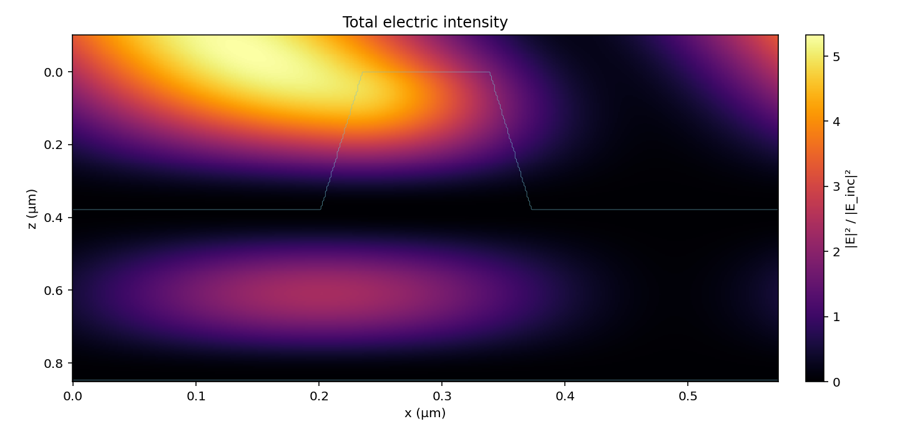

# 快速上手

StableRCWA 是一套只有头文件的 C++17 RCWA（严格耦合波分析）求解器：一维光栅的 TE/TM 与圆锥入射、二维交叉光栅，
另有 JSON 命令行程序和本机网页界面。FFT 库 pocketfft 已随头文件内置，不用另行下载、编译或安装任何库。

下面几步互相独立，挑需要的做，每一步都写了应当看到的结果。前三步只要一个 C++17 编译器（clang、g++ 或 MSVC），
第 4 步的图形界面另需 Python 3 与 NumPy、SciPy、Matplotlib。命令都在仓库根目录下运行，示例里的长度单位是 μm。

## 1. 跑通自带示例

```sh
c++ -std=c++17 -O2 -I include -I examples examples/rcwa_demo.cpp -o rcwa_demo
./rcwa_demo --case single --M 20
```

```text
结构 single，TE，M = 20（N = 41），本征分解用 QR 迭代
  第 1 级反射效率  98.586865 %
  R = 99.794843 %   T = 0.205157 %   R + T = 100.000000 %
```

这是 20 层介质膜上的单周期光栅，波长 1.053 μm、入射角 66.36°。结构没有吸收，所以 `R + T` 应当是 100.000000 %；
后面还有两行残差和用时，数值随机器略有不同。

- Linux：编译命令另加 `-pthread`。
- Windows：`g++ -std=c++17 -O2 -I include -I examples examples\rcwa_demo.cpp -o rcwa_demo.exe -static`，
  或 `cl /std:c++17 /O2 /EHsc /utf-8 /I include /I examples examples\rcwa_demo.cpp`。
  程序输出 UTF-8 中文，命令行窗口里先执行 `chcp 65001`，否则显示成乱码。

## 2. 算你自己的光栅

把下面的内容存成 `my_grating.cpp`：

```cpp
#include <cstdio>
#include "stablercwa/rcwa1d.hpp"
using namespace stablercwa;

int main() {
    rcwa::Stack stack;                       // 自上而下：入射介质、各层、出射介质
    stack.nI = 1.0;  stack.nII = 1.46;  stack.period = 0.574;
    // 光栅层：厚 0.38；一个周期里 [0, 0.172] 是折射率 1.46 的齿，[0.172, 0.574] 是空气
    stack.layers.push_back(rcwa::Layer::grating(0.38, {0.0, 0.172, 0.574}, {1.46, 1.0}));
    stack.layers.push_back(rcwa::Layer::uniform(0.115, 1.96));        // 均匀膜：厚 0.115，折射率 1.96

    const int M = 20;                        // 保留 −M … M 共 2M+1 个衍射级
    rcwa::Result r = rcwa::solve(stack, 1.053, 66.36, M, rcwa::Polarization::TE);   // 波长、入射角（度）

    for (int m = -1; m <= 1; ++m)
        std::printf("m = %+d   R = %.6f   T = %.6f\n", m, r.DEr[m + M], r.DEt[m + M]);
    std::printf("R + T = %.12f\n", r.reflectance() + r.transmittance());
}
```

```sh
c++ -std=c++17 -O2 -I include my_grating.cpp -o my_grating && ./my_grating
```

```text
m = -1   R = 0.000000   T = 0.000000
m = +0   R = 0.026034   T = 0.497012
m = +1   R = 0.258135   T = 0.218818
R + T = 1.000000000000
```

要改的通常只有这几处：

- 吸收介质的折射率写成 `cplx(n, k)`，`k > 0`；换偏振用 `rcwa::Polarization::TM`。
- 级次的符号：θ > 0 时，Littrow 入射下返回入射方向的是 `m = +1` 级，所以上面有能量的是 0 级和 +1 级。
  齿形左右不对称的光栅要按这个方向填边界，见[使用说明](user-guide.zh-CN.md)的“一维 RCWA”一节。
- 截断阶数 `M` 要自己做收敛检查：加大 `M`，看关心的效率是否不再变化。
- 求解失败时不抛异常，效率全部是 NaN，`r.eig_info` 给出本征求解的返回码。
- 圆锥入射用 `rcwa1d_conical.hpp` 的 `solve_conical`，二维交叉光栅用 `rcwa2d.hpp` 的 `solve2d`，
  写法见[使用说明](user-guide.zh-CN.md)的“圆锥入射”和“二维交叉光栅”两节。

## 3. 不写 C++：JSON 进，JSON 出

从 Python、MATLAB 或脚本里调用时，用 JSON 命令行程序最省事。把同一个结构存成 `request.json`：

```json
{
  "mode": "planar",
  "stack": {"nI": 1.0, "nII": 1.46, "period": 0.574,
            "layers": [{"d": 0.38, "edges": [0.0, 0.172, 0.574], "n_values": [1.46, 1.0]},
                       {"d": 0.115, "n": 1.96}]},
  "M": 20, "polarization": "TE",
  "points": [{"wavelength": 1.053, "theta_deg": 66.36}]
}
```

```sh
c++ -std=c++17 -O2 -I include -I examples examples/rcwa_json.cpp -o rcwa_json
./rcwa_json request.json --out reply.json
python3 -c "import json; r = json.load(open('reply.json'))['results'][0]; print(r['R_total'], r['T_total'])"
```

```text
0.2841691864361829 0.7158308135639393
```

与第 2 步是同一个结构，数字也相同。`points` 里可以写多个（波长，入射角）做扫描；加 `--pretty` 得到分行缩进的应答。
请求写错时应答是 `{"ok": false, "error": …, "where": 出错的字段}`，拼错的键也会报错。

- 圆锥入射：`"mode": "conical"`，去掉 `polarization`，每个点加 `"phi_deg"`，
  再加 `"input": {"psi_deg": 45, "delta_deg": 90}` 指定入射偏振。
- 二维交叉光栅：`"mode": "periodic2d"`，完整请求见下面折叠的例子。
- 全部字段写在 [include/stablercwa/rcwa_json.hpp](../include/stablercwa/rcwa_json.hpp) 的开头。

<details>
<summary>二维交叉光栅的请求（0.8 μm × 0.8 μm 周期里一个方柱，下面一层均匀膜）</summary>

```json
{
  "mode": "periodic2d",
  "stack": {"nI": 1.0, "nII": 1.46, "Lx": 0.8, "Ly": 0.8,
            "layers": [{"d": 0.3, "y_edges": [0.0, 0.25, 0.55, 0.8],
                        "x_profiles": [{"edges": [0.0, 0.8],              "n_values": [1.0]},
                                       {"edges": [0.0, 0.25, 0.55, 0.8], "n_values": [1.0, 1.8, 1.0]},
                                       {"edges": [0.0, 0.8],              "n_values": [1.0]}]},
                       {"d": 0.115, "n": 1.96}]},
  "M": 4, "My": 4,
  "points": [{"wavelength": 1.053, "theta_deg": 42.0, "phi_deg": -25.0}],
  "input": {"psi_deg": 90.0}
}
```

`y_edges` 把一个周期沿 y 分成几段，`x_profiles` 依次给出每段沿 x 的折射率分布。应答里 `orders` 是各级的 `[m, n]`，
`DEr`、`DEt` 按同样的次序给出效率；这个例子共 81 级，`sum(DEr) + sum(DEt)` 等于 1。

</details>

## 4. 图形界面

在浏览器里建模、计算、看近场，不用写代码。

- macOS：双击 `gui/启动GUI.command`。
- Windows：第一次先双击 `gui\install_windows.bat`（要求 Python 3.11 或 3.12 x64，安装时联网），以后双击 `gui\start_gui.bat`。
- 或者在任何装好依赖的终端里：

```sh
python3 -m pip install -r gui/requirements.txt
python3 gui/gui.py
```

浏览器会自动打开界面，地址是 `127.0.0.1` 上的本机服务，不联网。在“载入示例”里选 **MLD 梯形单周期 · 解析**，
点“开始计算”，一两秒后结果页显示总反射效率 99.747%、总透射效率 0.253%，以及下面这张电场强度图：



结果页可以切换六个场分量、幅值与相位。界面启动时会用系统里的 C++ 编译器自动编译求解程序；
找不到编译器时改由自带的 Python 求解器计算，结果页会注明。保持启动时的终端窗口开着，关掉它界面就退出。
操作细节见 [gui/GUI使用说明.md](../gui/GUI使用说明.md)。

## 5. 跑一遍测试（可选）

```sh
cmake -S . -B build -DCMAKE_BUILD_TYPE=Release
cmake --build build --config Release -j 6
cd build && ctest -C Release -j 4
```

共 25 项：21 个测试程序，另有 4 项检查 JSON 模式开关的条目。最后一行应当是 `100% tests passed, 0 tests failed out of 25`。
在 Apple M1 Pro 上构建约 30 秒、测试约 40 秒，其中 `test_eig_qr_parallel` 一项占了绝大部分时间。

## 接下来看哪里

| 想做什么 | 看哪里 |
| --- | --- |
| 接口约定、圆锥入射、`rcwa::Options`、失败时的行为 | [使用说明](user-guide.zh-CN.md) |
| 六分量近场与相位 | 使用说明的“六分量近场与相位”一节，[examples/rcwa_fields.cpp](../examples/rcwa_fields.cpp) |
| 二维交叉光栅的 C++ 接口、近场与用时 | 使用说明的“二维交叉光栅”一节；JSON 协议见 [PROTOCOL_2D.md](../gui/validation/field_reference_2d/PROTOCOL_2D.md) |
| 为什么高截断阶数下要用 QR 而不是 LR | [首页](../README.zh-CN.md)的 QR、LR 对照表；使用说明的“两种本征迭代”一节 |
| 多核与 GPU | 使用说明的“两种本征迭代”（多核并行）和“GPU 后端”两节 |
| 结果可信到什么程度 | [验证](validation.zh-CN.md)；讲解页 [圆锥入射-COMSOL对照](https://aikkkkko.github.io/StableRCWA/pages/圆锥入射-COMSOL对照.html)、[截止零根-Schur传播与COMSOL对拍](https://aikkkkko.github.io/StableRCWA/pages/截止零根-Schur传播与COMSOL对拍.html) |
