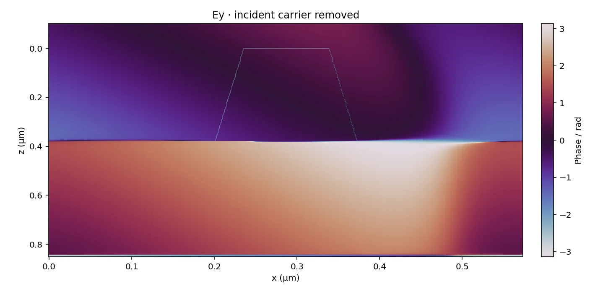
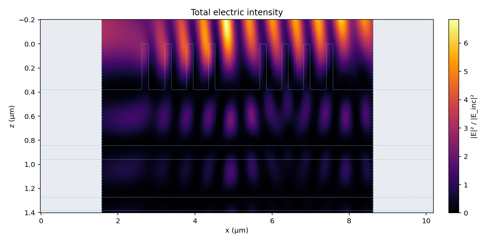

# 使用说明

这份说明写 StableRCWA 的接口约定和各部分的用法：一维 RCWA、圆锥入射、二维交叉光栅、六分量近场与相位、JSON 接口、图形界面、
两种本征迭代和 GPU 后端。第一次用请先看[快速上手](quickstart.zh-CN.md)，测试与对照见[验证](validation.zh-CN.md)。

StableRCWA 由一组纯源码的 C++17 数值模块组成：LU 分解、QR 分解、LR 与 QR 两种本征迭代，以及建立在它们之上的 RCWA：
一维光栅（平面内入射的 TE/TM，以及圆锥入射的 Jones 矩阵）和二维交叉光栅（x、y 两个方向都有周期，入射方向与偏振任意）。
全部是头文件，FFT 库 pocketfft 已内置，包含之后直接传参调用，不链接任何求解器或 FFT 库。折射率可以是复数（吸收介质）。
另有 JSON 进出的命令行程序和一份本机网页界面。

## 构建与最小用法

```cpp
#include "stablercwa/eig.hpp"
using namespace stablercwa;

Matrix A(n, n);                          // 复数、按列存放；A(i, j) 读写元素
// … 填入矩阵元 …
EigResult r = eig(A);                    // 默认 EigMethod::QR；r.values[j]、r.vectors 的第 j 列
double res = eig_residual(A, r);         // max ‖A v − λ v‖ / (‖A‖ ‖v‖)
```

```sh
c++ -std=c++17 -O2 -I include examples/eig_minimal.cpp -o eig_minimal && ./eig_minimal
c++ -std=c++17 -O2 -I include -I examples examples/rcwa_demo.cpp -o rcwa_demo
./rcwa_demo
./rcwa_demo --eig lr --M 150
./rcwa_demo --eig lr --M 120 --all-layers
./rcwa_demo --case absorb --M 60
```

Linux 上编译命令另加 `-pthread`。

四条 `rcwa_demo` 命令依次是：

- 默认算例，20 层介质膜上的单周期光栅，M = 100，QR 迭代：R + T = 100.000000 %；
- 光栅层改用 LR 迭代、M = 150：R + T 只有 86.9 % 左右，本征求解的返回码仍是 0；
- 21 层全部交给 LR 迭代、M = 120：本征对残差比 QR 迭代大十几个量级；
- 齿有吸收（复折射率）：R + T 小于 100 %。

全部选项写在 `examples/rcwa_demo.cpp` 的开头。

Windows 上用 MinGW g++ 或 MSVC 都可以（MSVC 需加 `/utf-8`，源文件含中文）：

```bat
g++ -std=c++17 -O2 -I include -I examples examples\rcwa_demo.cpp -o rcwa_demo.exe -static
cl /std:c++17 /O2 /EHsc /utf-8 /I include /I examples examples\rcwa_demo.cpp
```

程序的输出是 UTF-8 的中文。Windows 的命令行窗口里先执行 `chcp 65001` 再运行，否则显示成乱码（重定向到文件不受影响）。

也可以用 CMake（最低 3.16）：

```sh
cmake -S . -B build -DCMAKE_BUILD_TYPE=Release
cmake --build build --config Release
cd build && ctest -C Release
```

- 库目标是 `stablercwa`，别名 `StableRCWA::stablercwa`。它是 INTERFACE 目标：只带包含路径、C++17 要求、线程库，MSVC 下另加 `/utf-8`。
- 两个选项 `STABLERCWA_BUILD_EXAMPLES`、`STABLERCWA_BUILD_TESTS` 控制是否编译示例和测试，默认都打开。
  用 `add_subdirectory` 引入时，先把两者设为 `OFF`，再链接 `StableRCWA::stablercwa`，写法见首页。

## 仓库里的文件

```
include/stablercwa/
    matrix.hpp        Matrix（复数稠密矩阵，按列存放）、范数、矩阵乘法
    parallel.hpp      线程池、set_num_threads、parallel_for（只用标准库线程）
    lu.hpp            LU 分解：按列选主元 / 不选主元；解方程、求逆、增长因子
    qr.hpp            Householder QR 分解；解方程、最小二乘
    svd.hpp           单边 Jacobi 奇异值；2-范数条件数 cond2
    eig_types.hpp     EigMethod、EigOptions、EigResult：两种本征迭代共用的选项和返回值
    eig_qr.hpp        eig_qr()：Householder 化 Hessenberg 形 + QR 迭代（EISPACK CORTH + COMQR2）
    eig_lr.hpp        eig_lr()：消元化 Hessenberg 形 + LR 迭代（EISPACK COMHES + COMLR2），只作对照
    eig.hpp           统一入口 eig()、本征对残差、正交性缺损
    rcwa1d.hpp        一维 RCWA：TE/TM、复折射率、S 矩阵递推、扫描并行
    fourier.hpp       一维中点采样 FFT 系数、采样数检查与自动选择
    detail/pocketfft/ 内置 pocketfft 单头文件和 BSD-3-Clause 许可证
    rcwa1d_conical.hpp   一维 RCWA 的圆锥入射：各级的 2×2 Jones 矩阵与效率
    rcwa2d_types.hpp     二维（交叉光栅）RCWA 的类型：Stack2D、Layer2D、Options2D、Result2D
    rcwa2d_operators.hpp 二维的 Fourier 算子 ⟦ε⟧、Cx、Cy（Li 因式分解）
    rcwa2d.hpp           二维求解 solve2d()：各级的 s/p 复振幅与效率
    rcwa2d_fields.hpp    二维近场：solve2d_with_fields、field_at、x-z / y-z 切面与相位
    rcwa_fields.hpp      公共六分量容器、状态、归一化和几何/波矢元数据
    rcwa1d_fields.hpp    TE/TM solve_with_fields、field_at、field_map
    rcwa1d_conical_fields.hpp   圆锥两列入射基及正式场采样
    rcwa_phase.hpp       参考相位、复投影、弱场掩膜与 x/z 分段展开
    rcwa_fields_json.hpp 一次求解的效率/场/相位协议
    npy.hpp           NumPy 二进制数组写入（仅标准库）
    json.hpp          最小的 JSON 读写（只用标准库）
    rcwa_json.hpp     RCWA 的 JSON 入口：solve_json(请求) 返回应答（planar、conical、periodic2d 三种模式）
    stablercwa.hpp    核心与远场聚合；场上下文头文件单独包含
    gpu/cuda_backend.hpp   可选的 CUDA 后端（cuSOLVER / cuBLAS），单精度、双精度可切换
examples/
    eig_minimal.cpp   最小示例：填一个矩阵，调用 eig()
    rcwa_demo.cpp     命令行的 RCWA 示例：换结构、换本征算法，看能量是否守恒
    conical_demo.cpp  命令行的圆锥入射示例：各传播级四个偏振通道的效率、通量幺正性
    rcwa_json.cpp     效率/Jones 专用的 JSON 命令行程序
    rcwa_fields.cpp   一次求解的效率/Jones 与六复场/相位命令行程序；JSON + NPY 二进制传输
    bench_*.cpp       CPU/GPU 基准程序
    structures.hpp    示例共用的结构定义；say.hpp 是带中文格式串的 printf 转发
    run_tests_win.bat、run_bench_win.bat、build_gpu_win.bat、run_bench_mac.sh   构建和运行脚本
tests/                每个模块一个测试程序，自带 main()
gui/                  本机网页界面：符合条件的一维周期模型由 C++ 一次求解效率/Jones/六复场/相位，Python 建模与显示
docs/                 本说明、快速上手、验证报告和图片
```

## 一维 RCWA

```cpp
#include "stablercwa/rcwa1d.hpp"
using namespace stablercwa;

rcwa::Stack stack;                                   // 自上而下：入射介质、各层、出射介质
stack.nI = 1.0;  stack.nII = 1.46;  stack.period = 0.574;          // 长度单位任取，全程一致
stack.layers.push_back(rcwa::Layer::grating(0.38, {0.0, 0.172, 0.574}, {cplx(1.46, 0.05), 1.0}));
stack.layers.push_back(rcwa::Layer::uniform(0.115, 1.96));

rcwa::Result r = rcwa::solve(stack, 1.053, 66.36, 40, rcwa::Polarization::TE);
// r.DEr[m + 40]、r.DEt[m + 40]：第 m 级的反射、透射效率；r.reflectance() + r.transmittance()
```

约定：

- 级次 `m` 的横向波矢是 `kx_m = nI·sinθ − m·λ/Λ`（以 k0 为单位），场随 x 的变化是 `exp(−i·k0·kx_m·x)`。按这个约定，θ > 0 时入射波的横向波矢指向 −x，
  Littrow 入射时返回入射方向的是 `m = +1` 级。齿形左右不对称的光栅要按这个方向填 `edges`。
- 吸收介质写成 `n + i·k`，`k > 0`。入射介质必须是实折射率。
- `rcwa::Options` 里可以换本征算法（`eig`）、线性求解方法（`linear`）、关闭均匀层解析解（`homogeneous_fast_path = false`）、
  打开层间并行（`parallel_layers`）、换成自己的本征求解器（`custom_eig`，例如 GPU 后端）。
- 求解失败（方程奇异、出现非有限数、本征迭代不收敛）时不抛异常，返回的效率全部是 NaN，`eig_info` 记下本征求解的返回码。
- 平面有限层内数值上精确的 `q = 0`（传播常数严格为零）使用辅助模式基和线性场对应的散射块，不因此失败，也不修改物理本征值。
  例如 nI = nII = 2、θ = 30°、λ = 1 µm，中间一层 n = 1、厚 1/(π√3) µm 的膜（层内 q = 0）：解析解是 TE 的 `R = T = 1/2`、
  TM 的 `R = 1/17, T = 16/17`，与 COMSOL 的对照见[验证](validation.zh-CN.md)。
  近零而非零、亏损本征基及部分外部掠射边界仍有限制，见 `rcwa1d.hpp` 开头的说明。
- `rcwa::sweep(stack, points, M, pol, options)` 对一组（波长，入射角）并行求解，线程数由 `set_num_threads` 设定，结果与线程数无关。

## 一维 Fourier 系数：解析或 FFT

`Layer::grating` 默认保留解析积分。需要 FFT 时可为每层独立指定：

```cpp
auto layer = rcwa::Layer::grating(0.38, {0.0, 0.1722, 0.574}, {1.46, 1.0},
                                rcwa::FourierMethod::FFT, 65536);
// 也可修改现有层：
layer.fourier_method = rcwa::FourierMethod::FFT;
layer.fft_samples = 0;  // 自动选择
stack.layers.push_back(layer);
```

平面 TE/TM、圆锥入射、扫描及六分量近场共用该设置。同一堆栈可混用解析与 FFT 层，均匀层始终使用解析方式。
JSON 的一维层接受 `"fourier_method": "analytic" | "fft"` 和 `"fft_samples": N`，省略时分别为 `analytic`、`0`。
二维材料算子暂仍只使用解析积分。

`rcwa::resolve_fft_samples(M, N)` 返回实际点数：`0` 取不小于 `max(8192, 64*(2*M+1))` 的最小 2 次幂；
显式 `N` 不要求是 2 次幂，但必须大于 `4*M`，以独立保存 `-2M..2M` 的系数。点数上限 4194304，非法设置抛出
`std::invalid_argument`；JSON 会在对应层的 `fft_samples` 字段报错。

只需要系数时可包含 `stablercwa/fourier.hpp`，调用：

```cpp
auto c = rcwa::fourier_coefficients_fft(edges, values, period, hmax, N);
// c[h+hmax] = c_h，f(x) = Σ c_h exp(+i 2πh x/period)，须 N > 2*hmax。
```

实现与 `gui/spectral1d.py` 一致：在 `edges[0] + (j+1/2)*period/N` 处取分段材料值，做前向 FFT 并除以 N，
再补偿绝对原点和半采样间距的相位。边界恰好落在采样点时取右侧分段。复材料不作共轭对称假设；ε 与 1/ε 分别采样、分别 FFT，
保留 TM 与圆锥算法的 Li 逆规则。FFT 引入材料离散误差，需要增加 N 检查收敛，也仍需检查 M。

FFT 使用随源码固定版本的 [pocketfft](https://github.com/mreineck/pocketfft)，无需外部链接。
来源、固定 commit 和 BSD-3-Clause 许可见 `include/stablercwa/detail/pocketfft/`。
每次 FFT 使用一个线程，层间和扫描并行仍由 StableRCWA 管理。

## 圆锥入射

`rcwa1d_conical.hpp` 把一维 RCWA 推广到入射面不垂直于栅线的情形。入射方向由入射角 θ 和方位角 φ（入射面与光栅矢量 x 的夹角）给出，
φ = 0 就是上一节的平面内入射。这时 s、p 两种偏振互相耦合，每一级的结果不再是一个振幅，而是反射、透射各一个 2×2 的 Jones 矩阵，
以及四个偏振通道的效率。结构的写法、`rcwa::Options`、求解失败时的约定都与 `rcwa::solve` 相同。

```cpp
#include <cstdio>
#include "stablercwa/rcwa1d_conical.hpp"
using namespace stablercwa;

int main() {
    rcwa::Stack stack;                                   // 结构的写法与 rcwa::solve 完全相同
    stack.nI = 1.0;  stack.nII = 1.46;  stack.period = 0.574;
    stack.layers.push_back(rcwa::Layer::grating(0.38, {0.0, 0.172, 0.574}, {1.46, 1.0}));
    stack.layers.push_back(rcwa::Layer::uniform(0.115, 1.96));

    const int M = 20;
    rcwa::ConicalResult r = rcwa::solve_conical(stack, 1.053, 66.36, 17.0, M);   // 波长、θ、φ、截断阶数
    // r.Jr[m + M]、r.Jt[m + M]：第 m 级反射、透射的 2×2 Jones 矩阵，.sp 是“p 入、s 出”的复振幅
    // r.DEr[m + M].ss … .pp、r.DEt[m + M]：四个偏振通道各自的效率

    rcwa::ConicalPolarized c = r.for_angles(45.0, 90.0);  // 入射偏振 [Es, Ep] = [sin ψ·exp(iδ), cos ψ]，这里是圆偏振
    // c.DEr[m + M]、c.DEt[m + M]：这种入射下第 m 级的效率；c.reflectance() + c.transmittance()

    if (r.n_schur > 0) std::printf("Schur propagation used in %d layer(s)\n", r.n_schur);
}
```

```sh
c++ -std=c++17 -O2 -I include -I examples examples/conical_demo.cpp -o conical_demo
./conical_demo --phi 17 --psi 45 --delta 90
```

约定（没有提到的都沿用上一节）：

- 第 `m` 级的横向波矢是 `kx_m = nI·sinθ·cosφ − m·λ/Λ`、`ky = nI·sinθ·sinφ`（各级相同）。每一级有自己的衍射面（波矢与 z 轴所在的平面），
  方位角 `φ_m = atan2(ky, kx_m)` 在 `r.phi_m_deg` 里。s 分量垂直于这一级的衍射面，p 分量在衍射面内、垂直于波矢，每一束波都满足 p̂ × ŝ = k̂。
- Jones 矩阵的行是输出 (s, p)，列是输入 (s, p)：`Jr[m].ab` 是输入 b 偏振、单位电场幅值时第 m 级反射电场的 a 分量。
  通道效率 `DEr[m].ab = flux_r[m]·|Jr[m].ab|²`，`flux_r[m] = Re(kz_m)/(nI·cosθ)`，透射同理。无吸收时 `r.flux_unitarity()` 是 2×2 的单位矩阵，
  它比 R + T = 1 多管三个实数。
- 入射偏振：`r.for_angles(ψ, δ)` 对应 `[Es, Ep] = [sinψ·exp(iδ), cosψ]`，ψ = 90° 是 s、ψ = 0° 是 p；`r.for_input(Es, Ep)` 直接给 Jones 矢量。
- φ = 0 时与 `rcwa::solve` 的对应：`Jr[m].ss = σ_m·σ_0·R_TE[m]`，`Jt[m].ss = σ_m·σ_0·T_TE[m]`，`Jr[m].pp = σ_m·σ_0·R_TM[m]`，
  `Jt[m].pp = σ_m·σ_0·(nI/nII)·T_TM[m]`，σ_m = cos φ_m（由 `r.phi_m_deg[m]` 读出），就是 `kx_m` 的符号；恰好沿法线衍射的级次（`|kx_m| ≤ 1e-14`）按零算，取 +1；各级效率与 TE、TM 的相等，交叉偏振的通道严格为零。
- 入射介质和出射介质都必须是实折射率，各层可以有吸收。
- `ky ≠ 0` 时，两次 N 阶分解拼出的模式可能在 `Kx² − ⟦ε⟧` 或另一支算符的零本征值附近退化。
  每层独立检查 `min|λ| < 1e-2·|ky|^1.5`；只对触发层改用完整 2N 阶 Schur 分解及矩阵平方根、矩阵指数，保留三角（Jordan）耦合。
  `r.min_abs_lambda` 保留约化本征值的诊断，`r.degenerate_mode_warning` 表示触发退化检测，`r.n_schur` 记录切换层数。
  警告不表示结果必然失准；真正的传播常数 `q = 0` 或矩阵函数求解失败仍按数值失败处理。
  附加 Schur 分解使用内置 QR（`custom_eig` 仍负责原两次 N 阶分解），每个触发层在 `n_eig` 中另计一次。
  `solve_conical` 输出远场，`solve_conical_with_fields` 同时保存完整 Schur 场状态。
  Python 近场采用相同的 Schur 基、矩阵传播和内部振幅，并对平面有限层精确零根恢复线性场。
- `rcwa::sweep_conical(stack, points, M, options)` 对一组（波长，θ，φ）并行求解，结果与线程数无关。

用时：每个光栅层做两次 N = 2M+1 阶的本征分解，界面上的稠密运算是 2N 阶的；均匀层照样用解析解：最下面一个光栅层以下的膜层再多也不增加稠密运算；
光栅层以上的膜每层多一次 2N 阶的稠密求解。单线程实测（带 20 层膜的光栅，M = 60 和 100），一次 `solve_conical` 的用时约是一次 TE 的 `rcwa::solve` 的 5 倍，
是 TE、TM 各算一次之和的 2.3 倍；φ = 0 时两支不耦合，约是一次 TE 的 3.3 倍。

## 二维交叉光栅

`rcwa2d.hpp` 求解 x、y 两个方向都有周期的结构（矩形格子，周期 `Lx`、`Ly`）。入射方向由 θ、φ 给出，入射偏振是一个 Jones 矢量，
结果是每个 (m, n) 级的 s、p 复振幅和效率。公共名字都带 `2D` 或 `2d` 后缀，可以与一维的头文件放在同一个翻译单元里。

```cpp
#include <cstdio>
#include "stablercwa/rcwa2d.hpp"
using namespace stablercwa;

int main() {
    rcwa::Stack2D stack;                               // 自上而下：入射介质、各层、出射介质
    stack.nI = 1.0;  stack.nII = 1.46;  stack.Lx = 0.8;  stack.Ly = 0.8;
    // 结构层：沿 y 分三段，中间一段里沿 x 的 [0.25, 0.55] 是折射率 1.8 的方柱，其余是空气
    rcwa::XProfile2D air{{0.0, 0.8}, {1.0}}, bar{{0.0, 0.25, 0.55, 0.8}, {1.0, 1.8, 1.0}};
    stack.layers.push_back(rcwa::Layer2D::patterned(0.3, {0.0, 0.25, 0.55, 0.8}, {air, bar, air}));
    stack.layers.push_back(rcwa::Layer2D::uniform(0.115, 1.96));

    const int M = 4;                                   // x、y 方向各保留 −M … M，谐波总数 N = (2M+1)² = 81
    // 波长、θ、φ、x 与 y 方向的截断阶数、入射偏振（ψ = 90° 是 s）
    rcwa::Result2D r = rcwa::solve2d(stack, 1.053, 42.0, -25.0, M, M, rcwa::jones_from_angles_2d(90.0));
    if (r.status != rcwa::Status2D::Ok) { std::printf("%s\n", r.message.c_str()); return 1; }
    // r.DEr[rcwa::harmonic_index_2d(m, n, M, M)]、r.DEt[…]：(m, n) 级的反射、透射效率
    // r.Rs、r.Rp、r.Ts、r.Tp：各级的 s、p 复振幅
    std::printf("R = %.6f   T = %.6f\n", r.reflectance(), r.transmittance());   // R = 0.163646   T = 0.836354
}
```

约定：

- 几何：每个结构层沿 y 分成几段（`y_edges`），每段内沿 x 分段常数（一个 `XProfile2D`），矩形的柱、孔及其组合都这样写。
  边界必须递增，首尾恰好相差一个周期，起点不必是 0。均匀层只给厚度和折射率。
- 级次 (m, n) 的横向波矢是 `Kx = nI·sinθ·cosφ − m·λ/Lx`、`Ky = nI·sinθ·sinφ − n·λ/Ly`（以 k0 为单位），
  场的横向因子是 `exp[−i·k0·(Kx·x + Ky·y)]`，与前两节一致。两个方向分别截断：`m = −M1…M1`、`n = −M2…M2`，共 `N = (2M1+1)(2M2+1)` 级。
  结果数组长 N，m 在外层、n 在内层，`harmonic_index_2d(m, n, M1, M2)` 给出下标；`r.m`、`r.n` 是各列对应的级次，`r.i0` 是 (0, 0) 级的下标。
- 入射偏振：`jones_from_angles_2d(ψ, δ)` 给出 `[Es, Ep] = [sinψ·exp(iδ), cosψ]`，ψ = 90° 是 s、ψ = 0° 是 p，与圆锥入射的 `for_angles` 相同；
  也可以直接写 `rcwa::Jones2D{Es, Ep}`。Jones 矢量不在求解里归一（`jones_from_angles_2d` 给出的模为 1）。
- 入射介质必须是实折射率；各层和出射介质可以有吸收（`n + i·k`，`k > 0`）。
- `rcwa::Options2D`：Fourier 因式分解默认是 Li 的嵌套逆规则（`Factorization2D::Li`），`Laurent` 收敛差，只作对照；
  `parallel_layers` 把各结构层分给线程池；`custom_eig` 换成自己的本征求解器。本征分解用默认的 QR：LR 在二维的 2N 阶矩阵上不可靠，
  选了它时 `solve2d` 总是检查本征残差，超过 1e-9 就返回数值失败，不会悄悄给出错误的结果。
- 求解失败时不抛异常：`r.status` 是 `NumericalFailure` 或 `RayleighAnomaly`，`r.message` 写明原因，结果数组填 NaN。
  入射区、出射区或均匀层里某一级的 kz 恰好为 0 时报 `RayleighAnomaly`（一维允许入射区掠射，二维不允许）。
  参数非法（周期非正、边界不递增或不恰好覆盖一个周期、|θ| ≥ 90° 等）抛 `std::invalid_argument`。

近场在 `rcwa2d_fields.hpp` 里，一次求解之后可以反复采样，不再做本征分解：

```cpp
#include "stablercwa/rcwa2d_fields.hpp"

rcwa::FieldResult2D run = rcwa::solve2d_with_fields(stack, 1.053, 42.0, -25.0, M, M, rcwa::jones_from_angles_2d(90.0));
RealVector zs{-0.1, 0.15, 0.5};                        // z = 0 是结构上表面，z 指向出射侧
rcwa::FieldGridSlice xz = rcwa::field_slice(run, zs, rcwa::SlicePlane::XZ, 300, 0.4);   // 固定 y = 0.4 的 x-z 面，沿 x 取 300 点
cplx Ex = xz.at(rcwa::FieldComponent::Ex, 1, 10);      // z 下标、x 下标
rcwa::PhaseGrid phase = rcwa::phase_slice(run, zs, rcwa::SlicePlane::XZ, 300, 0.4, rcwa::FieldComponent::Ex);
```

`run.result` 与 `solve2d` 的结果逐位相同；`SlicePlane::YZ` 是固定 x 的 y-z 面；`field_at(run, z)` 给出任意 z 处六个分量的谐波列。
归一化与一维相同：E 对入射电场归一，磁场存的是 `Z0 H`。区域归属、Ez 的符号等细节写在 `rcwa2d_fields.hpp` 的开头。

用时：每个结构层做一次 2N 阶的本征分解，用时大致按 N³ 增长。均匀层走分块对角的快路径，结构层之下的膜层几乎不增加用时，
结构层之上的每层膜要多存一份 2N 阶的稠密矩阵。矩阵阶数 2N ≥ 192 时 `eig_qr` 使用 `set_num_threads` 设定的线程池。
上面的例子（一个结构层加一层膜）在 Apple M1 Pro 上的实测如下（`-O2`，只供估计量级）：

| M1 = M2 | N | 1 线程 | 6 线程 | 总反射 R |
| --- | --- | --- | --- | --- |
| 4 | 81 | 0.03 s | 0.03 s | 0.163646 |
| 6 | 169 | 0.26 s | 0.17 s | 0.163422 |
| 8 | 289 | 1.3 s | 0.62 s | 0.163245 |
| 12 | 625 | 13 s | 4.4 s | 0.163214 |

最后一列说明二维的截断收敛比一维慢：M 从 4 加到 12，R 的第四位小数还在变。截断阶数要自己做收敛检查。

JSON 接口的 `periodic2d` 模式见下面“JSON 接口与命令行程序”一节。图形界面里二维模型默认由 Python 求解器计算，原因和开关见“图形界面”一节。

## 六分量近场与相位

[数值约定与接口说明](../gui/validation/field_reference/CONTRACT.md)固定六复分量、归一化、传播、界面归属和相位规则；
[12 个固定参照与验证入口](../gui/validation/field_reference/README.md)保存独立解析、零根、Schur 和相位的参照。

`solve_with_fields` / `solve_conical_with_fields` 在同一次求解中保存模式、材料算符和层顶 / 层底振幅。
`field_at` 返回六分量 Fourier 谐波，`field_map` 合成实空间复场；`phase_data` 处理绝对 / 相对入射 / 自定义参考、复投影、弱场掩膜和分段展开。

```cpp
#include "stablercwa/rcwa1d_fields.hpp"
#include "stablercwa/rcwa1d_conical_fields.hpp"
#include "stablercwa/rcwa_phase.hpp"
namespace rcwa = stablercwa::rcwa;

auto result = rcwa::solve_conical_with_fields(stack, 1.053, 66.36, 17.0, 20);
result.fields.require_available();
auto input = rcwa::jones_from_angles(45.0, 90.0);
auto harmonics = rcwa::field_at(result, 0.1, input);
auto grid = rcwa::field_map(result, {0.0, 0.05, 0.1, 0.2}, 256, 0.0, input);
rcwa::PhaseOptions options;
options.reference = rcwa::PhaseReference::Incident;
options.unwrap = rcwa::PhaseUnwrap::Both;  // 先 x 后 z，分别在未掩膜连续段内展开
options.phase_floor = 1e-6;
auto phase = rcwa::phase_data(grid, rcwa::FieldComponent::Ex, options);
auto Ex = grid.at(rcwa::FieldComponent::Ex, 1, 10);  // z 下标、x 下标
// phase.at(iz,ix) 为弧度；phase.masked(iz,ix) 为 true 时相位无定义。
```

- 平面 `solve_with_fields` 的结果使用相同采样函数，省略 Jones 参数。原始磁场是 `Z0 H`；TE 的入射 `Ey = 1`，TM 的入射 `Z0 Hy = 1`，圆锥的入射电场范数为 1。
- 网格每分量的 `Matrix` 为 `[nx, nz]` 列存储，连续内存等价于 NumPy `[nz, nx]` 的 C 顺序。
- 任意、重复和空深度输入均有定义；没有正厚有限层时，`z = 0` 取出射侧。严格零根使用线性场，Schur 层保留完整耦合。
- 上下文独立拥有数据，可深拷贝；移动后源对象为 `Empty`。求解或场状态不可用时为 `Unavailable`，公开采样会拒绝访问。
- 普通 `solve` / `solve_conical` 走原来的效率路径；反复采样与事后换入射偏振不再做本征分解。



<sub>图：界面预设“MLD 梯形单周期 · 解析”，Ey 的相位，已去掉入射波的空间载波（`PhaseReference::Incident`）。六复场、两种参考的相位和掩膜由 C++ 一次求解给出。</sub>

## JSON 接口与命令行程序

`rcwa_json.hpp` 给 RCWA 加了一个 JSON 进、JSON 出的入口，方便从别的语言或界面调用：

```cpp
#include "stablercwa/rcwa_json.hpp"
std::string reply = stablercwa::rcwa::solve_json(request);   // 请求、应答都是一段 JSON 文字
```

命令行程序是 `examples/rcwa_json.cpp`，请求从文件或标准输入读，应答写到标准输出或 `--out` 指定的文件：

```sh
c++ -std=c++17 -O2 -I include -I examples examples/rcwa_json.cpp -o rcwa_json
./rcwa_json 请求.json --out 应答.json
```

```json
{
  "mode": "planar",
  "stack": {"nI": 1.0, "nII": 1.46, "period": 0.574,
            "layers": [{"d": 0.38, "edges": [0.0, 0.1722, 0.574], "n_values": [1.46, 1.0]},
                       {"d": 0.115, "n": [1.96, 0.0]}]},
  "M": 20, "polarization": "TE",
  "points": [{"wavelength": 1.053, "theta_deg": 66.36}]
}
```

- `mode` 是 `"planar"`（TE/TM）、`"conical"`（圆锥入射，每个点另有 `phi_deg`）或 `"periodic2d"`（二维交叉光栅）。多个入射点写在 `points` 里，用 `options.threads` 个线程并行。
- 二维请求的结构里用 `Lx`、`Ly` 代替 `period`，结构层写 `y_edges` 与 `x_profiles`，截断写 `M` 和 `My`，入射偏振 `input` 必须写；
  应答里 `orders` 是各级的 `[m, n]`，每个结果带 `status`。完整的例子在[快速上手](quickstart.zh-CN.md)第 3 步，逐项说明在 `rcwa_json.hpp` 开头的最后一节。
- 折射率写成一个实数，或者 `[实部, 虚部]`（例子里的 `n_values` 是两段各一个实数）；应答里的复数一律是 `[实部, 虚部]`。
  应答里的数读回来，与直接调用 `rcwa::solve`、`rcwa::solve_conical`、`rcwa::solve2d` 得到的逐位相同。
- 请求有错时应答是 `{"ok": false, "error": 说明, "where": 出错的字段}`，程序返回 1；不认识的键也算错，免得拼错了悄悄被忽略。
  求解本身数值失败不算请求出错：`ok` 仍为真，相应的数写成 `null`。
- 请求和应答的完整格式写在 `rcwa_json.hpp` 开头。JSON 的读写在 `json.hpp` 里，同样只用标准库，数与文字的转换在三套工具链上逐位一致。
- 不需要圆锥入射或二维时，可以在包含 `rcwa_json.hpp` 之前把 `STABLERCWA_RCWA_JSON_CONICAL` 或 `STABLERCWA_RCWA_JSON_2D` 定义为 0，
  不编入对应的求解器；请求这两种模式时得到说明原因的错误，平面入射照常求解。

完整近场入口是 `rcwa_fields_json.hpp` / `examples/rcwa_fields.cpp`（CMake 目标 `rcwa_fields`）：

- 请求包含 `solve`（一个入射点，写法同上）、`sampling: {z: [...], nx: ... [, y: ...]}`、新建的 `output_dir` 和 `request_id`。
- 同一次 C++ 求解得到效率/Jones 与六复场，然后计算 absolute / incident 包裹相位和弱场掩膜。
- JSON 只返回小型的效率、诊断、版本与文件描述；五个 NPY 文件保存六场 `[6, nz, nx]`、相位和掩膜 `[2, 6, nz, nx]`、x/z 坐标。
  NPY 为 C 布局、little endian 的 complex128 / float64 和 uint8。
- 文件先写临时目录，成功后整体发布；失败不会返回有效的场清单。已有的输出目录拒绝覆盖。`rcwa_json` 的协议保持效率专用。
- 二维的近场请求另有切面方向（xz 或 yz）、沿切面的采样数与固定坐标，协议见 [PROTOCOL_2D.md](../gui/validation/field_reference_2d/PROTOCOL_2D.md)。

## 图形界面

`gui/` 是一份本机网页界面：Python 起一个只监听 127.0.0.1 的服务，在浏览器里建模、计算、看结果。
操作细节见 [gui/GUI使用说明.md](../gui/GUI使用说明.md)。

**启动：** macOS 双击 `gui/启动GUI.command`；Windows 第一次先运行 `gui\install_windows.bat`，以后运行 `gui\start_gui.bat`；
或者在装有 NumPy、SciPy、Matplotlib 的 Python 里运行 `python gui/gui.py`。

**一维模型：**

- 各向同性、解析或 FFT Fourier 的平面 TE/TM 与圆锥模型，由 C++ 一次求解各级效率、Jones、六复场和相位；Python 负责建模、显示与保存。
  界面启动时会自动把 `examples/rcwa_fields.cpp` 编译到 `gui/bin/`，需要系统里有 C++ 编译器。
- 正常的 C++ 路径不再重复做 Python 数值求解；设 `RCWA_VERIFY_PYTHON=1` 才另做一次 Python 求解来核对。
  切换分量和相位时读取预存的 C++ 相位与掩膜。
- 横向 PML（有限、非周期结构）、单轴晶体的一维模型由 Python 求解。
- Python 的周期平面 / 圆锥路径同样支持有限层精确零根与圆锥 Schur 近场；`field_at` 与 `field_map` 共用传播核。
  PML、二维、磁性扩展以及外部精确掠射边界保持原来的限制。



<sub>图：界面预设“有限 MLD 光栅 · PML”，左右各 4 条刻线，两侧横向 PML；TE，λ = 1.053 µm，θ = 66.36°，M = 120。
总电场强度 |E|²/|E_inc|²，由 Python 求解器计算。</sub>

**二维周期模型（交叉光栅，`periodic2d`）：**

- **默认由 Python 求解器计算，不走 C++。** 实测 C++ 的二维本征分解在每个谐波数 N 上都比 Python 慢（数字见 `GUI使用说明.md` 的“速度与磁盘”一节）。
  在 C++ 的二维本征分解实测不慢于 Python 之前，默认不切过去；默认值是常量 `cpp_backend.DEFAULT_BACKEND_2D`，注释里写着改回的条件。
  默认时结果页的“未用 C++”一行是一句中性的说明，不是故障。
- **打开 C++ 路径：** 先设环境变量 `RCWA_2D_BACKEND=cpp` 再启动界面（启动脚本不改环境，`gui.py` 把环境原样交给工作进程）。
  macOS 在终端里运行 `RCWA_2D_BACKEND=cpp ./gui/启动GUI.command`；Windows 在命令行里 `set RCWA_2D_BACKEND=cpp` 之后运行 `gui\start_gui.bat`
  （双击启动时用系统环境变量）。这个开关只管二维，一维的路由不受影响；`RCWA_BACKEND=cpp` 不是有效取值，不会打开二维的 C++。
- 打开之后，C++ 一次求解各级效率，以及 xz 或 yz 切面上的六复场和相位。条件：材料各向同性、解析 Fourier 系数（Li 因式分解）、
  谐波总数 `(2M+1)(2My+1) ≤ 625`。协议见 [PROTOCOL_2D.md](../gui/validation/field_reference_2d/PROTOCOL_2D.md)。
- 二维没有横向 PML、单轴晶体、FFT Fourier 系数与磁性介质：界面入口（`normalize_2d`）直接拒绝这几类二维模型，不交给任何求解器。

**回退与核对（二维 C++ 路径）：**

- C++ 不可用、数值失败（含二维 Rayleigh 异常点）或输出失败时，完整回退到 Python，并写明原因。
- 二维应答除了格式，还核对物理自洽：Kx、Ky、kz 按请求独立重算（含 kz 的取支与传播判据）；逐级的 Rs/Rp/Ts/Tp 与远场 Ez 对 Ex/Ey；
  效率对振幅与 kz；叠层之外的每一行对远场应答；相位对六复场；应答里的线程数、计时、本征分解次数对请求与调用的墙上时间。
  形式正确但数值被改过的应答因此被拒绝并退回 Python。
- 不论用户的 z 范围是什么，界面总在叠层之前、之后各多算一行隐藏的探针行（离界面 max(0.02 个波长, 1e-8 µm)），
  把入射偏振与相位、反射/透射振幅钉在请求上，校验完即从所有数据里去掉。用户的数据与没有探针时逐位相同，只有一个有界的例外：
  用户的行深在强吸收膜里、场比探针行小得多时，弱场掩膜要按用户自己的行重新取峰值，由 Python 补上相位的那些点上，
  两个相位参考与不加探针的运行相差不超过 1e-14 rad；六个场、E2、掩膜与其余各点的相位仍逐位相同。
- **这些检查看不出的情形：**
  1. 自洽却物理上不同的整套结果，例如求解器内部对调两层厚度、读错某层折射率、镜像结构，或者远场与叠层之外的场被一致地改写、叠层内部不变。
     只有 `RCWA_VERIFY_PYTHON=1` 的独立求解能发现。
  2. 叠层之内（0 ≤ z ≤ 叠层底面）各行的改动，以及两个界面两侧各 1e-9 µm 内的行（那里两侧的 Ez、Hz 本来不连续，不检查）。
     叠层之外的检查看不到它们，场文件里这些行没有独立的参照。
  3. 取整允许量以内的改动：一般小于峰值的 1e-9，掠入射（θ = 89.9°）约 1e-8，波长相对 |z| 极小的极端参数下更大
     （`PROTOCOL_2D.md` 6.3 节有分布与每个分量的检出下限）。允许量超过 1e-3 的行（相位检查则整项）被明确跳过，并写进 `backend.note`。
  4. 采样点数 nz × nt 加上两行探针会超过协议上限 4000000 时不加探针，并在 `backend.note` 写明（界面上限 1600 × 1200 远低于它），
     这时只有用户自己的叠层之外的行受检查。
  5. 应答里只“报告”的诊断量（`n_dense_solve`，有结构层时的 `max_eig_residual`），以及计时：只检查上界（不超过墙上时间的 1.05 倍加 1 s）。
- 取消：界面的“取消”终止工作进程。Windows 上终止不给工作进程清理的机会，界面服务器随后删掉该任务目录里的 `cpp_fields-*`。

**环境变量：**

| 变量 | 作用 |
| --- | --- |
| `RCWA_BACKEND=python` | 一维、二维都只用 Python 求解器 |
| `RCWA_2D_BACKEND=cpp` | 二维周期模型改用 C++（默认是 `python`） |
| `RCWA_VERIFY_PYTHON=1` | C++ 求解之后另做一次 Python 求解来核对 |
| `RCWA_FIELDS_EXE=路径` | 用这个完整场程序，不再查找和编译 |
| `RCWA_JSON_EXE=路径` | 只供旧的效率 API 使用；只设它时界面完整回退 Python，并提示改用 `RCWA_FIELDS_EXE` |

**测试：** 在 `gui/` 目录里运行

```sh
python -m unittest validation.test_cpp_fields_backend validation.test_cpp_backend validation.test_degenerate_fields validation.test_cpp_2d_backend
```

最后一项是二维：请求、应答的逐项校验与篡改、回退、端到端、HTTP。它内置一个按协议实现的替身程序，没有 C++ 程序也能跑，有则对真实程序再跑一遍。
全部 Python 测试用 `python -m unittest discover -s validation -p "test_*.py"`（`validation/` 没有 `__init__.py`，不加参数的 `python -m unittest` 找不到任何测试）。

## 两种本征迭代

`eig(A, EigMethod::QR)` 是正式使用的算法，`EigMethod::LR` 只为对照而保留。两者的结构相同，
实质的差别只有每一步用的变换：QR 迭代用酉变换，累积变换的条件数恒为 1；LR 迭代用消元变换，累积变换的条件数随矩阵阶数指数增长，
阶数高时本征向量不可用，而且返回码仍然是 0。首页的 QR、LR 对照表就是这个现象。

两个例程照 EISPACK 原版编写，算法上的改动只有一处：回代时如果两个本征值之差小于 `eps·max(|λi|, |λj|)`，按这个值而不是算出来的差去除。
两个本征值在舍入误差以内重合时，算出来的差可以是 1e-30 这样的数，原样去除会得到两个几乎平行的本征向量，而残差仍然很小。
恰好正入射或 Littrow 入射时，均匀层的层矩阵就有这样成对重合的本征值。
循环次序、极端量级下的缩放这些写法上的差别，写在两个头文件开头的说明里。

每个本征值最多迭代 30 次（`EigOptions::max_iter`），不做平衡。极少数有重本征值的亏损矩阵需要调大这个上限，
未收敛时 `EigResult::info > 0`。

**多核并行：**

- `eig_qr` 在阶数 n ≥ 192 时使用 `set_num_threads` 设定的线程池做多核并行（化 Hessenberg 形、累乘 Z、QR 迭代里链以外的更新、回代）；调用方式不变。
  线程数为 1、或者调用发生在别的并行区里（`parallel_for` 的循环体、`parallel_layers`、`sweep()`）时，同样的计算在调用线程上依次完成。
- 保证的范围：编译器不把 a*b+c 融合成 fma 时（GCC、Clang 加 `-ffp-contract=off`；MSVC 默认的 `/fp:precise`），多线程的结果与单线程的结果、
  与并行化之前的串行实现逐位相同：本征值、本征向量、Z、T、迭代次数、返回码，以及每次观察者回调时的 H、Z。
  验收测试是 `tests/test_eig_qr_parallel.cpp`。唯一的例外是结果本身为 NaN 的情形（元素量级超出下面声明的范围，例如全为 `DBL_MAX`）：NaN 的符号位与载荷不在保证之内。
- 开着乘加融合时没有验证，结果的末位可能与旧版、与别的线程数的结果不同。这包括 GCC 加 `-march=native`、MSVC 加 `/fp:contract`、Clang 加 `-ffp-contract=fast`，
  以及 Clang 在 arm64 上的默认值 `-ffp-contract=on`（Apple 芯片上不加选项的构建、界面在 Mac 上自动编译的后端都属于这一类）。
  需要逐位可重复时请加 `-ffp-contract=off`。
- 观察者回调在调用 `eig_qr` 的线程上发生；`eig_qr` 本身在别的并行区里被调用时，回调仍在那个并行区之内，回调里不能调用 `set_num_threads`。

矩阵元整体的量级在 1e-150 到 1e150 之间时，不会因为上溢或下溢出错。由于不做平衡，同一个矩阵里元素大小悬殊时本征值可能失准，
而返回码仍是 0、残差仍然很小。例如 `[[2, 1e20], [1e-20, 3]]` 算出的本征值是 2 和 3，正确值是 1.382 和 3.618。这类矩阵要先做对角相似缩放再调用。

## GPU 后端（可选）

`include/stablercwa/gpu/cuda_backend.hpp` 把本征分解、线性求解、矩阵乘法转交给 CUDA Toolkit 自带的 cuSOLVER / cuBLAS。
需要 CUDA Toolkit 12.6 或更新的版本；没有自己写的 CUDA 内核，用普通 C++ 编译器即可。构建命令见 `examples/build_gpu_win.bat`。
只在 Windows 加 CUDA 12.6 上测过，属于实验性功能。

```cpp
#include "stablercwa/rcwa1d.hpp"
#include "stablercwa/gpu/cuda_backend.hpp"
using namespace stablercwa;

gpu::Context ctx;                                   // 默认双精度；gpu::Context ctx(gpu::Precision::Single) 为单精度
EigResult r = gpu::eig(ctx, A);
rcwa::Options opt;
opt.custom_eig = [&](const Matrix& a) { return gpu::eig(ctx, a); };
```

同一个 `Context` 不能被两个线程同时使用。线程数大于 1 时，设了 `custom_eig` 的选项不要打开 `parallel_layers`，也不要传给 `sweep()`。
RCWA 里能这样替换的只有本征分解；`gpu::solve` 和 `gpu::multiply` 供单独调用。

单精度只用来估计吞吐量，残差在 1e-6 量级，不能当作正式结果。
